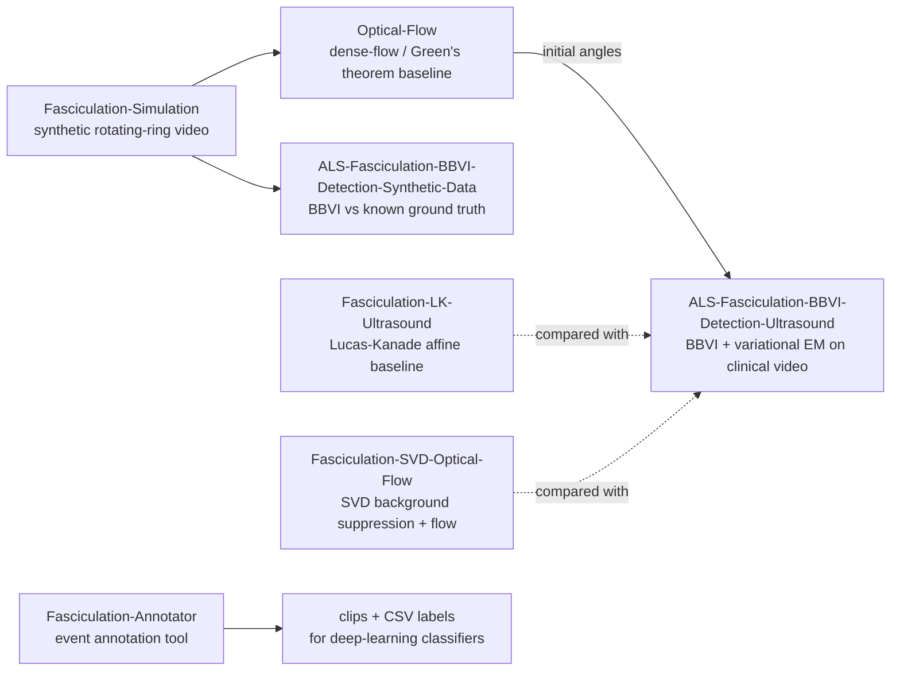

## Turrnum Shahzadi

Ph.D. candidate in Electrical Engineering and Computer Science at **Tokyo Metropolitan University** (Tagawa Lab),
expected September 2027. I work on **medical image and video analysis, computer vision and probabilistic machine
learning**: detecting fasciculations in ALS muscle ultrasound with variational inference, and segmenting and grading
lumbar spine MRI with deep learning.

[Website](https://shzditrnum.github.io) · [Email](mailto:turrnum@gmail.com) · Tokyo, Japan

**Tools:** Python · PyTorch · TensorFlow/Keras · OpenCV · nnU-Net · Docker · Linux GPU servers

---

### Featured work

| Project | What it is | Status |
|---|---|---|
| [**diffusion-policy-pusht-repro**](https://github.com/ShzdiTrnum/diffusion-policy-pusht-repro) | From-scratch re-implementation of Diffusion Policy (RSS 2023) on Push-T. 3 seeds × 10 checkpoints × 50 episodes: 0.866 ± 0.038 vs 0.91 reported; plus DDIM sampler-latency and failure-prediction studies | Reproduction + extensions |
| [**nnunet-revisited-acdc**](https://github.com/ShzdiTrnum/nnunet-revisited-acdc) | Reproduction of nnU-Net Revisited (MICCAI 2024) on ACDC: nnU-Net, ResEnc M/L, 5-fold CV, resumable 2-GPU training queue | Training in progress |
| [**ALS-Fasciculation-BBVI-Detection-Ultrasound**](https://github.com/ShzdiTrnum/ALS-Fasciculation-BBVI-Detection-Ultrasound) | Black-box variational inference + variational EM for ring-wise rotation estimation in ALS ultrasound (VISAPP 2026) | Paper code |
| [**Fasciculation-Annotator**](https://github.com/ShzdiTrnum/Fasciculation-Annotator) | PySide6/OpenCV desktop tool for frame-accurate annotation of fasciculation events; exports clips + CSV for deep learning | Tool |
| [**CNN-LSS-Detection**](https://github.com/ShzdiTrnum/CNN-LSS-Detection) | Four-grade lumbar spine stenosis classification from axial MRI (Diagnostics 2023), with a leakage-free evaluation protocol and tests | Paper code |

### ALS fasciculation pipeline

My Ph.D. code is split into stage-wise repositories:

- [Fasciculation-Simulation](https://github.com/ShzdiTrnum/Fasciculation-Simulation): synthetic videos with known rotation
- [Optical-Flow](https://github.com/ShzdiTrnum/Optical-Flow): dense-flow baseline that also gives BBVI its initial angles
- [ALS-Fasciculation-BBVI-Detection-Synthetic-Data](https://github.com/ShzdiTrnum/ALS-Fasciculation-BBVI-Detection-Synthetic-Data): validation against ground truth
- [ALS-Fasciculation-BBVI-Detection-Ultrasound](https://github.com/ShzdiTrnum/ALS-Fasciculation-BBVI-Detection-Ultrasound): the clinical-data method
- [Fasciculation-LK-Ultrasound](https://github.com/ShzdiTrnum/Fasciculation-LK-Ultrasound) · [Fasciculation-SVD-Optical-Flow](https://github.com/ShzdiTrnum/Fasciculation-SVD-Optical-Flow): classical baselines
- [Fasciculation-Annotator](https://github.com/ShzdiTrnum/Fasciculation-Annotator): annotation tool

Clinical ultrasound data from Tokyo Metropolitan Neurological Hospital is not redistributed; the synthetic
pipeline runs end to end with public inputs.

### Publications

- **Structured Variational Inference for Radius-Dependent Rotational Motion Estimation of Fasciculations in ALS Muscle Ultrasound.** T. Shahzadi, J. Zhou, K. Bokuda, N. Tagawa. *Springer CCIS*, 2026 (accepted).
- **Fasciculation Detection in Ultrasound Images for ALS Diagnosis Based on Black Box Variational Inference.** T. Shahzadi, J. Zhou, K. Bokuda, N. Tagawa. *VISAPP 2026* (oral). [doi](https://doi.org/10.5220/0014623000004084) · [code](https://github.com/ShzdiTrnum/ALS-Fasciculation-BBVI-Detection-Ultrasound)
- **Fasciculation Detection in Ultrasound Images for ALS Diagnosis Using BBVI.** T. Shahzadi, S. Tarashima, N. Tagawa, K. Bokuda. *IEEE IUS 2025*.
- **Oriented Racket Database (ORDB): Annotated Dataset for Rotated Racket Detection in Badminton.** M. A. Haq\*, X. Sun\*, T. Shahzadi\*, B. Zhang, S. Tarashima, N. Tagawa. *ACM MMSports Workshop 2025* (\*equal contribution).
- **Nerve Root Compression Analysis to Find Lumbar Spine Stenosis on MRI Using CNN.** T. Shahzadi et al. *Diagnostics* 13(18), 2975, 2023. [doi](https://doi.org/10.3390/diagnostics13182975) · [code](https://github.com/ShzdiTrnum/CNN-LSS-Detection)

Full list on my [website](https://shzditrnum.github.io).
